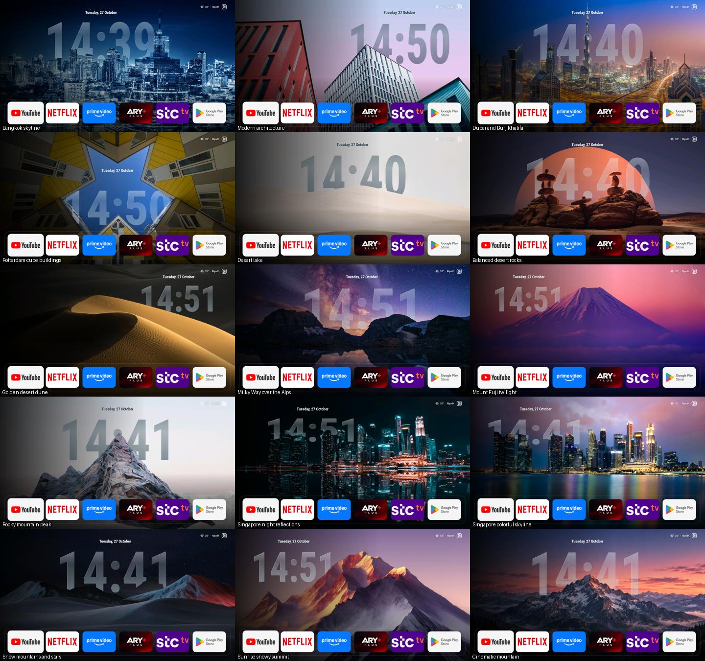

# Glassio Cinema for Skyworth

A custom Android TV launcher based on [Glassio 1.9.8](https://github.com/mohammadmrh12/glassio), adapted and tested on the **Skyworth SWTV-22AE / SW6H running Android TV 11**.

Current device-tested build: **1.9.8-cinema.3 (132)**. Application ID: `com.glasslauncher.cinema`; the original Glassio package remains separate.



## Custom features

- Fifteen curated wallpaper scenes with individual edge-fitted alpha masks. A live clock is drawn between sky and foreground, with a translucent fill and subtle highlight.
- Always-24-hour `HH:mm` depth clock. Date and clock use safe top margins and per-scene placement.
- Persistent four-hour wallpaper shuffle, avoiding immediate repeats and covering the collection before starting another shuffled cycle. It advances when the launcher is visible, including after time spent asleep or on HDMI, without waking the TV.
- Home closes menus/folders and returns focus to the first dock app. Down/Left escape the settings icon.
- Selected tiles enlarge around their center, with equal vertical dock padding and no upward lift.
- A simple Apps grid glyph, rectangular ARY Plus tile, Riyadh weather and the saved dock appearance.
- Upstream self-update polling disabled to preserve the custom application identity and signature.

This is a layered occlusion and glass-style effect. It is not full iOS optical refraction or 3D parallax, and arbitrary new photos need matching masks.

## Build

Requirements: JDK 17, Android SDK platform 36, and Android build tools compatible with AGP 8.13.2. The Gradle 9 wrapper is included. Kotlin/Compose 2.4.21 and an R8 9.1.29 override are pinned in the build scripts.

Create an untracked `local.properties` with your SDK path:

```properties
sdk.dir=/absolute/path/to/Android/Sdk
```

On Windows:

```powershell
.\gradlew.bat :app:testDebugUnitTest :app:assembleRelease
```

On macOS/Linux:

```sh
chmod +x gradlew
./gradlew :app:testDebugUnitTest :app:assembleRelease
```

The release configuration currently uses the local Android debug signing key, matching the development installation. **Signing keys are not in this repository.** A build signed with a different key cannot update an existing installation in place. Preserve the original key separately for future device updates.

Optional upstream Trakt/Nuvio integrations read their client configuration from untracked `local.properties`; they are not needed for the local wallpaper clock.

## Install and Home routing

Build output: `app/build/outputs/apk/release/app-release.apk`. Enable debugging on the TV, connect ADB to your TV's address, then install with:

```sh
adb install -r app-release.apk
```

Open Glassio Cinema and enable its Home-button accessibility service through TV settings. Replacing the APK may require toggling that service off and on. Keep the original launcher available for recovery.

On the tested Skyworth firmware, disabling Google TV Home sent Home to the manufacturer's recovery activity. That trial was reverted. **The stock Home launcher remains enabled; complete removal of the startup flash is unresolved.** Do not disable setup/recovery or Input services to force the handover.

## Verification

- Optimized release compilation, release lint and APK signature verification passed.
- Four shuffle unit tests passed, including the exact interval boundary, queue persistence, repeat avoidance and changed/empty file lists.
- Every minute of the day was assessed for digit visibility across all fifteen scenes on desktop; actual TV screenshots were reviewed separately.
- Focus screenshot measurements: selected tile 184 px high versus 170 px unselected, both with vertical center 922.5 px (0 px shift).
- All fifteen scenes captured on the TV; final adjusted layouts recaptured.

See [validation notes](docs/cinema/validation.md). Cold-boot behavior and full physical Input/streaming regression remain separate pending checks.

## Device cleanup

Six optional packages were verified disabled: E-Pop Player, Demo Now, SmartDevice Recommendations, Google Feedback, Sky Market and SwaiotHomeTV. Nine explicitly selected user apps were removed; hidden dock apps remain installed.

The full [cleanyourtv](https://github.com/Gathin23/cleanyourtv) preset was not applied. Its Android 14 firmware assumptions differ from this Android 11 device. On this TV, `fusion.android.tv.demo` handles the physical Input menu and must remain enabled. This repository does not automatically debloat a TV.

## Source and asset licensing

Glassio source code and these code modifications are licensed under **GPL-3.0**; see [LICENSE](LICENSE). The upstream project and its documentation are preserved in [UPSTREAM-README.md](UPSTREAM-README.md).

Roboto Condensed's license is bundled at `app/src/main/assets/cinema/CLOCK-FONT-OFL.txt`. Other bundled fonts retain their original files and upstream attribution. Wallpaper photographs were supplied for this private project; the code license does not grant rights to redistribute those photographs. See [ASSETS.md](ASSETS.md).

## Recovery helper

The parameterized PowerShell helper in tools/Restore-Google-TV-Home.ps1 removes only the two Glassio Home interception services, preserves other accessibility services, re-enables Google TV Home and opens it. Run it manually with -Device YOUR_TV_ADDRESS:5555 and an available adb executable. No device address or private ADB key is saved in this repository. It does not run automatically.

